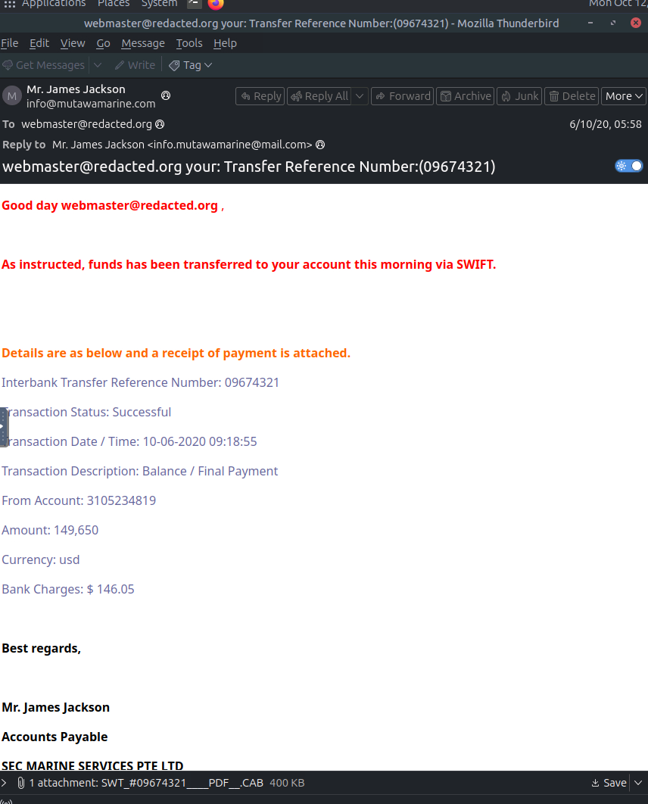
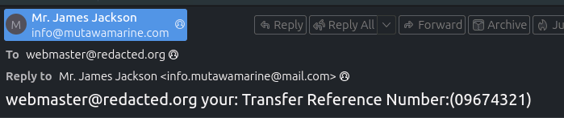
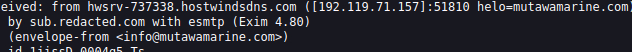
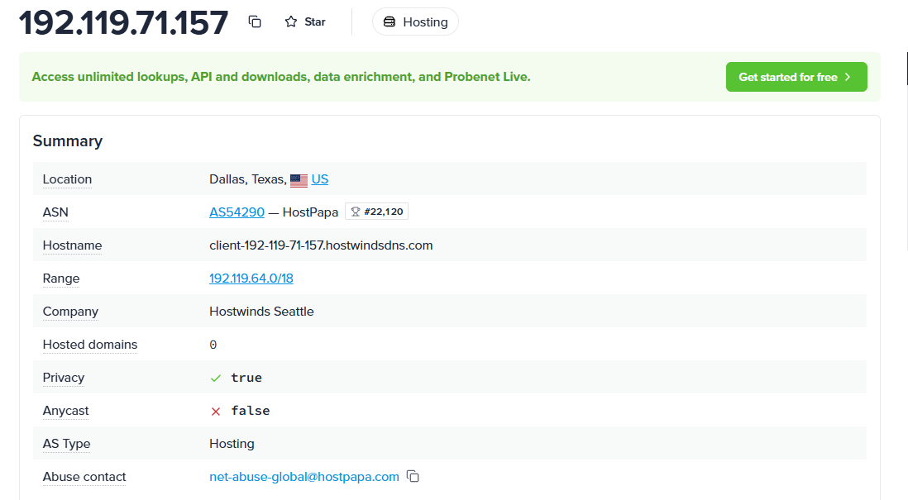
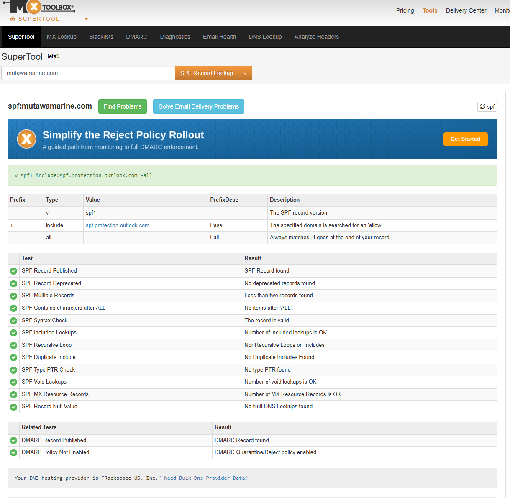
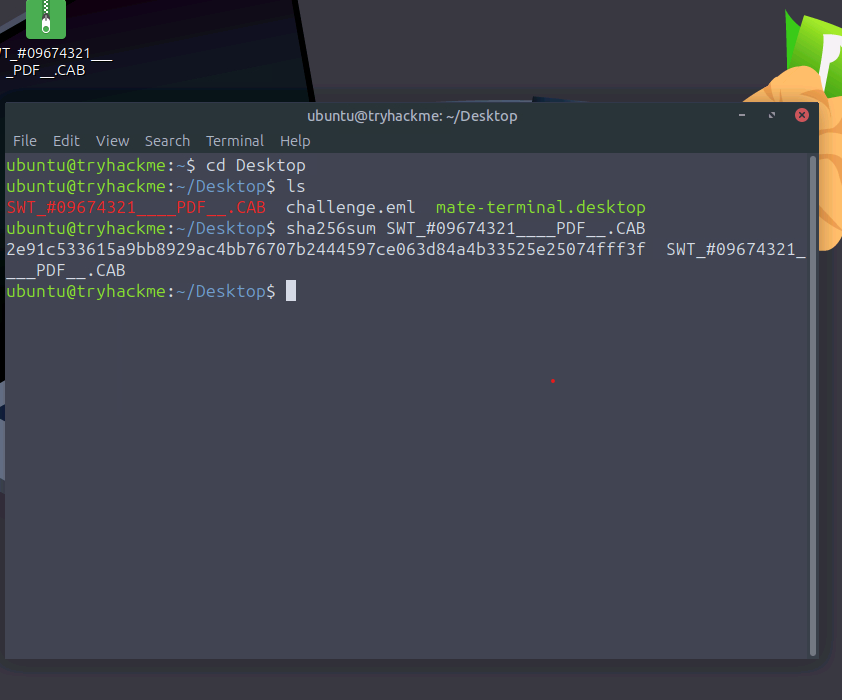
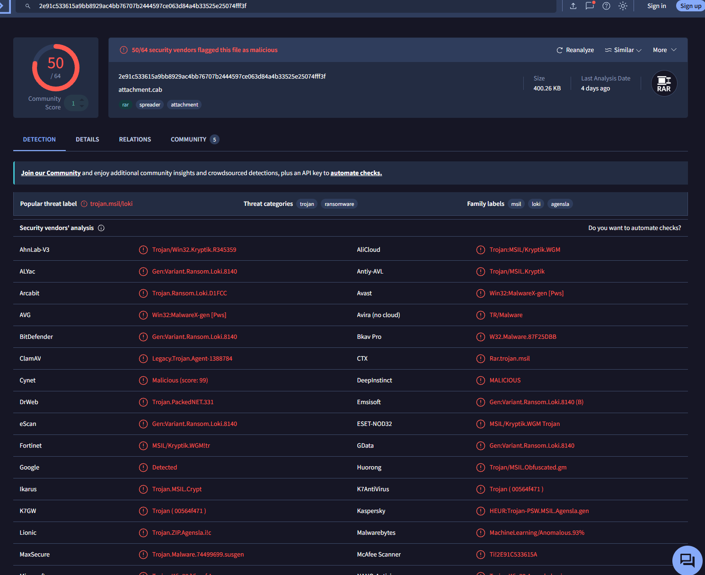
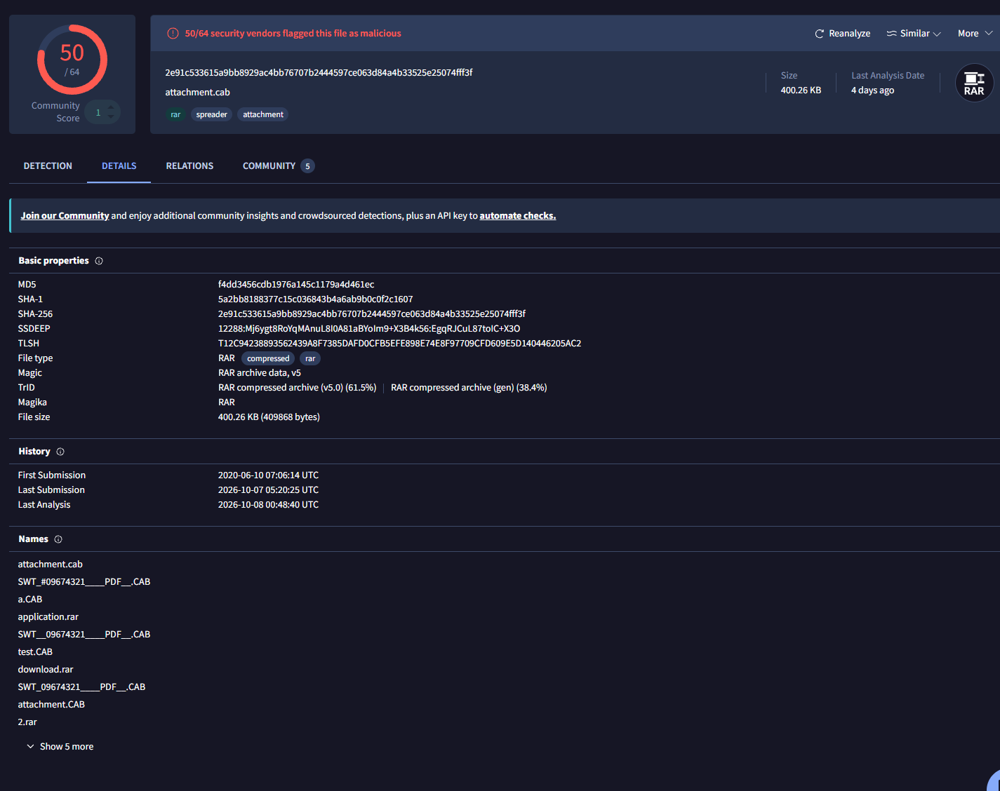

# Greenholt Phish: Email Triage and Malicious Attachment Analysis

**Platform:** TryHackMe, SOC Level 1 challenge room
**Role:** SOC Tier 1 analyst triaging a user-reported email
**Verdict:** Malicious. Spoofed-sender phishing email delivering a credential-stealing trojan

---

## Summary

A user reported an unexpected "payment received" email with an attached receipt. Header analysis showed that the email claimed to come from a marine services company. In fact it was sent from a rented hosting server, not the company's Microsoft 365 mail infrastructure, and replies were routed to a free webmail inbox. The attachment was disguised as a PDF but was actually a RAR archive. VirusTotal flagged it as malicious with 50 of 64 vendors, and the labels point to an MSIL information stealer. I recommend blocking the indicators below and checking whether any user opened the attachment.

---

## Investigation

### 1. Initial review of the email

The body is a classic payment lure:

- Unsolicited notice that **$149,650 was sent via SWIFT** "as instructed", with a "receipt" attached
- The greeting uses the recipient's email address instead of a name ("Good day webmaster@...")
- Grammar errors ("funds has been transferred")
- The signature names **SEC Marine Services Pte Ltd**, which does not match the sending domain, **mutawamarine.com**
- Attachment: `SWT_#09674321____PDF__.CAB` (400 KB). "PDF" is padded into the filename, but the real extension is `.CAB`

The lure works by urgency and curiosity: a large unexpected payment makes the recipient want to open the receipt.

### 2. Sender and Reply-To mismatch

| Field | Value |
|---|---|
| Display name | Mr. James Jackson |
| From | info@mutawamarine.com |
| Reply-To | info.mutawamarine@mail.com |

The From address appears to be a real business domain, but replies go to a **free mail.com inbox** controlled by the attacker. This is the single strongest red flag in the headers: a legitimate accounts payable department does not route replies to a free webmail account.

### 3. Tracing the true origin

Received headers are stacked newest on top, so the bottom-most entry shows where the message entered the mail chain:

- **Originating IP:** 192.119.71.157
- **Sending host:** hwsrv-737338.hostwindsdns.com
- **HELO:** mutawamarine.com (the server *claimed* to be the domain)
- **Envelope-from:** info@mutawamarine.com

| Attribute | Value |
|---|---|
| ASN | AS54290 (HostPapa) |
| Company | Hostwinds |
| AS type | Hosting |
| Location | Dallas, Texas, US |

The email came from a **commercial hosting provider's server**, not from corporate mail infrastructure. Anyone can rent a server like this.

### 4. Email authentication (SPF / DMARC)

The SPF and DMARC records were looked up for the envelope-from domain (mutawamarine.com), since that is the domain these checks evaluate:

- **SPF:** `v=spf1 include:spf.protection.outlook.com -all`
- **DMARC:** `p=quarantine` with `fo=1`

**What this means:** the real mutawamarine.com domain authorizes **only Microsoft 365 servers** to send its mail, and the `-all` hard fail tells receivers to reject anything else. This email came from a Hostwinds server, which is not covered by that record, so it would fail SPF. With a DMARC quarantine policy, it should have been routed to spam/quarantine. This points to **domain spoofing**: the attacker used a legitimate company's domain without access to its mail system.

### 5. Attachment analysis

The attachment was saved inside an isolated analysis VM and hashed. It was **never opened or executed**.

| Attribute | Value |
|---|---|
| Detection | **50 / 64** vendors flagged it malicious |
| Actual file type | **RAR archive (v5)**, not a PDF or CAB |
| Size | 400.26 KB (409,868 bytes) |
| Popular threat label | trojan.msil/loki |
| Family labels | msil, loki, agensla |
| First seen on VirusTotal | 2020-06-10, the same day the email was sent |

The file uses a **double disguise**: a "PDF" name to look like a receipt, a `.CAB` extension, and RAR content underneath. Vendor labels vary, but most point to a **.NET (MSIL) information stealer** (Loki and Agensla families; Kaspersky classifies it as Trojan-PSW, a password stealer). Its first submission was on the same day the email arrived, which means it was a fresh payload at the time of the campaign.

---

## Indicators of Compromise

| Type | Indicator |
|---|---|
| Sender address (spoofed) | info@mutawamarine.com |
| Reply-To | info.mutawamarine@mail.com |
| Originating IP | 192.119.71.157 |
| Sending host | hwsrv-737338.hostwindsdns.com |
| Attachment name | SWT_#09674321____PDF__.CAB |
| SHA256 | 2e91c533615a9bb8929ac4bb76707b2444597ce063d84a4b33525e25074fff3f |
| SHA1 | 5a2bb8188377c15c036843b4a6ab9b0c0f2c1607 |
| MD5 | f4dd3456cdb1976a145c1179a4d461ec |

## MITRE ATT&CK Mapping

| Technique | ID | Evidence |
|---|---|---|
| Phishing: Spearphishing Attachment | T1566.001 | Malicious archive delivered as a payment receipt |
| Masquerading: Masquerade File Type | T1036.008 | RAR archive disguised with a "PDF" name and .CAB extension |
| User Execution: Malicious File | T1204.002 | Payload depends on the user opening the attachment |

---

## Verdict and Recommended Actions

**Verdict:** True positive. Malicious phishing email with a credential-stealing malware payload.

**Containment and response:**
1. Block the Reply-To address and the originating IP at the email gateway
2. Block the attachment hash in the email security and EDR tools
3. Search all mailboxes for this message (subject, sender, hash) and purge every copy
4. Identify any user who opened the attachment. Isolate their host, investigate it, and **reset that user's passwords**, since the payload is a password stealer
5. Warn users about the payment-receipt lure
6. Notify mutawamarine.com that its domain is being spoofed

## Lessons Learned

- **The From address can lie, so check Reply-To.** A free webmail Reply-To on a "business" email is a high-confidence phishing signal.
- **SPF/DMARC evaluate the envelope-from domain**, not the display name or Reply-To. Comparing the sending IP against the domain's SPF record is what exposed the spoofing here.
- **Never trust the filename or extension.** Identify the true file type from its contents (VirusTotal, `file` command) and handle suspicious attachments only by hash inside an isolated environment.
