# Snapped Phish-ing Line: Credential Harvesting Campaign Investigation

**Platform:** TryHackMe (SOC Level 1 challenge room)
**Scenario:** SwiftSpend Financial. Multiple employees reported suspicious emails, and some had already entered their credentials.
**Role:** SOC analyst investigating the campaign end to end: emails, phishing site, attacker infrastructure, and phishing kit.
**Verdict:** True positive. Coordinated credential-harvesting campaign impersonating Microsoft 365. Credentials for at least four employees were captured and exfiltrated to an attacker-controlled mailbox.

---

## Summary

Several SwiftSpend employees received emails from a lookalike vendor domain (`groupmarketingonline.icu`) carrying attachments themed as invoices and payment notices. One attachment was a small HTML file that silently redirected the victim to a fake Microsoft 365 login page hosted on `kennaroads.buzz`, with the victim's email address pre-filled.

The attacker's server had directory listing enabled, which exposed the full phishing kit (`Update365.zip`) and a live log of stolen credentials. Analysis of the kit identified the attacker's collection mailbox, the mechanism used to trick victims into entering their password twice, and the kit author's signature.

---

## Investigation

### 1. The phishing emails


| Field | Value |
|---|---|
| From | `Accounts.Payable@groupmarketingonline.icu` |
| To | William McClean (`william.mcclean@swiftspend.finance`) |
| Subject | Quote for Services Rendered: processed on June 29, 2020, 10:01:32 AM |
| Attachment | `Quote.pdf` (107 KB) |

Red flags:
- **`.icu` top-level domain**: cheap and heavily abused for phishing infrastructure.
- **The same sender address appears across multiple emails to different employees**, confirming a single coordinated campaign rather than isolated spam.
- **Fabricated signature**: placeholder `555` phone numbers and a nonexistent address ("New Island").
- **Generic, urgency-free pretext** ("As discussed, please find attached quote") designed to look like routine accounts-payable traffic.
- The organization's own **external sender banner** fired, so the mail gateway flagged it as external, but it was not blocked.

### 2. The HTML attachment

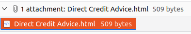

Zoe Duncan received `Direct Credit Advice.html` (509 bytes). An HTML file arriving as an "advice" document is itself a red flag: it executes in the browser when opened.

To inspect it safely, I opened it **as source text in a text editor** rather than letting the OS open it in a browser.

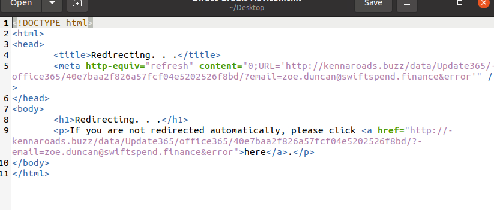

The file contains no real content, only a `meta refresh` redirect with a delay of `0` seconds:

```
http://kennaroads.buzz/data/Update365/office365/40e7baa2f826a57fcf04e5202526f8bd/?email=zoe.duncan@swiftspend.finance&error
```

Two details matter here:
- **`?email=` pre-fills the victim's address**, so the fake page looks personalized and trustworthy.
- **`&error`** tells the kit to show a fake "wrong password" message, prompting the victim to enter their password a second time (see section 6).

### 3. The phishing page

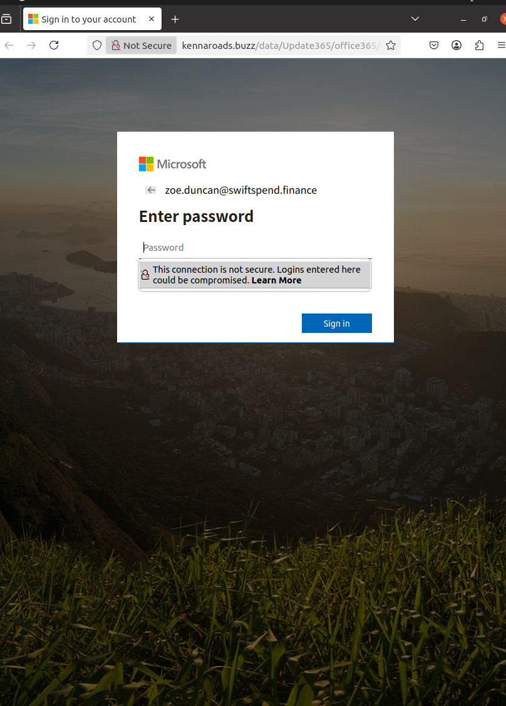

Opened only inside the isolated analysis VM. The page impersonates the **Microsoft 365 sign-in flow**, with Zoe's address already filled in. Giveaways: served over plain **HTTP** (browser shows "Not Secure"), and the domain is `kennaroads.buzz`, not a Microsoft domain.

### 4. Exposed attacker infrastructure

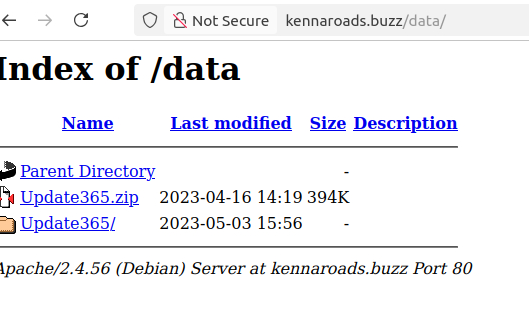

Browsing up to `/data/` on the phishing server revealed **directory listing was enabled** (Apache/2.4.56 on Debian). The attacker left their own phishing kit, `Update365.zip`, available for download, alongside the extracted working folder `Update365/`.

### 5. Phishing kit analysis

I downloaded the archive inside the VM and hashed it without extracting or executing anything first:

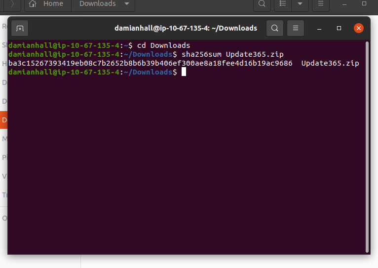

```
SHA256: ba3c15267393419eb08c7b2652b8b6b39b406ef300ae8a18fee4d16b19ac9686
```

The hash was then looked up on VirusTotal (a safe step: you're searching a text string, not handling the file).

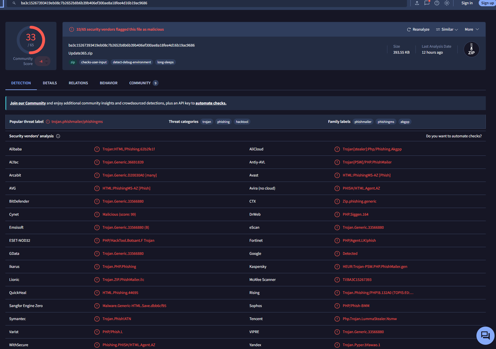

- **33/65** vendors flag it as malicious
- Popular threat label: **`trojan.phishmailer/phishingms`**
- Threat categories: **trojan, phishing, hacktool**
- Kaspersky classifies it as `HEUR:Trojan-PSW.PHP.PhishMailer.gen`, a PHP-based credential stealer (PSW = password stealing)


The archive contains **49 files** (520.27 KB uncompressed).

Extracting the kit in the VM shows its structure:

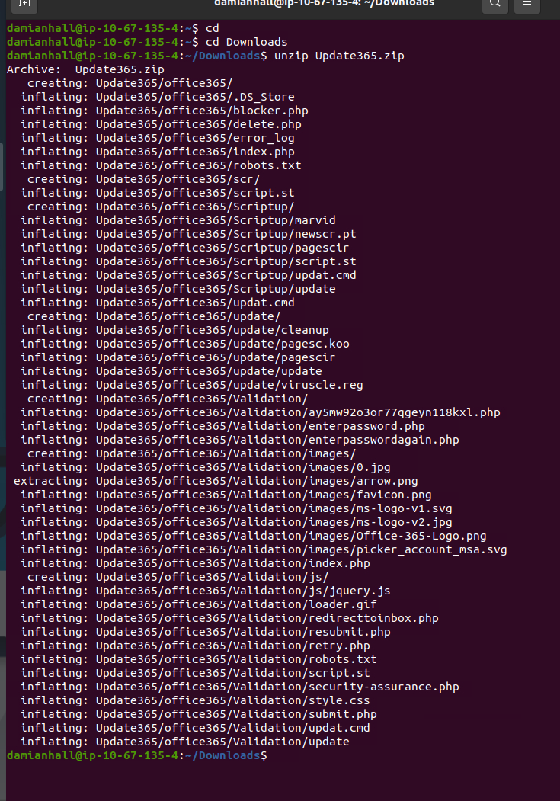

Notable components:
| File | Purpose |
|---|---|
| `Validation/enterpassword.php` / `enterpasswordagain.php` | First and "retry" password prompts |
| `Validation/retry.php`, `resubmit.php` | Fake-error flow that harvests a second password attempt |
| `Validation/submit.php` | Sends captured credentials to the attacker |
| `Validation/redirecttoinbox.php` | Sends the victim on to a real-looking destination afterwards so nothing seems wrong |
| `blocker.php` | Likely filters out security scanners and crawlers to keep the page from being detected |
| `.DS_Store` | macOS metadata file, an artifact suggesting the kit was packaged on a Mac |

### 6. Credential exfiltration

Searching the kit for the delivery logic (`find . -name submit.php`, then `grep @ submit.php`):

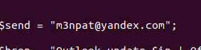

Captured credentials are emailed in real time to **`m3npat@yandex.com`**. This is the most important finding in the investigation: **taking the phishing site down does not recover anything already sent to this mailbox**, so every captured account must be treated as compromised.

### 7. Captured credentials log

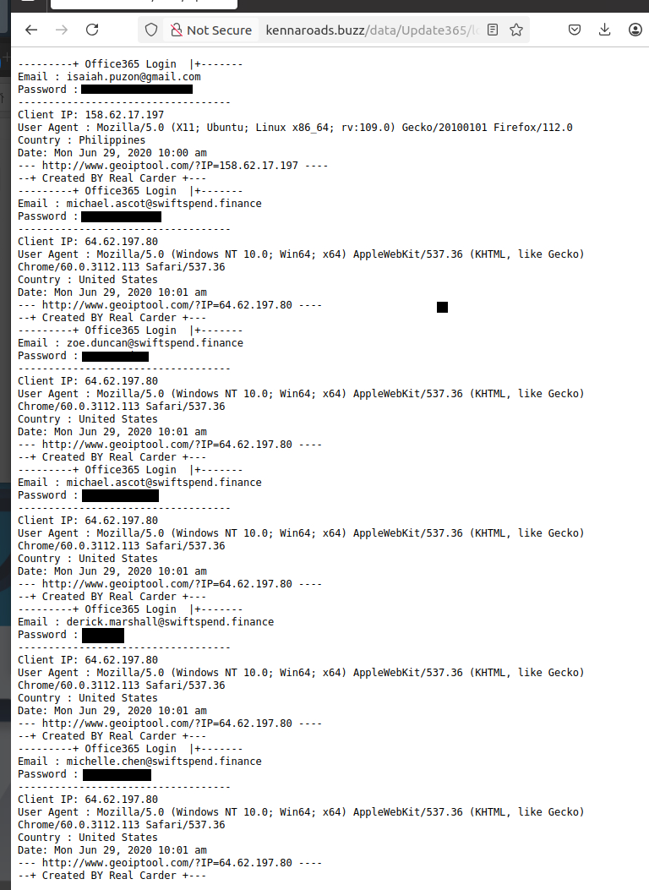
*(Passwords redacted.)*

The exposed `log.txt` on the server records each submission with email, password, client IP, user agent, geolocation, and timestamp. Each entry is tagged **"Created BY Real Carder"**, the kit author's signature, useful for attributing other kits by the same author.

Findings from the log:
- **Four SwiftSpend accounts submitted credentials** on June 29, 2020 between 10:00 and 10:01 AM: `michael.ascot`, `zoe.duncan`, `derick.marshall`, and `michelle.chen`.
- **`michael.ascot` submitted twice**, which is exactly what the `&error` / `enterpasswordagain.php` flow is designed to produce. Two attempts give the attacker a better chance of capturing the correct password (or two different passwords the user reuses).
- Two of the entries look like junk values, possibly users who grew suspicious. **They are still treated as compromised**, since a user who typed something fake may also have typed something real elsewhere.
- One early entry, a Gmail address from a Philippine IP a minute before the victims, is plausibly the operator **testing the kit** before or during the campaign. This is an inference, not confirmed.

### 8. Bonus: hidden value in the kit

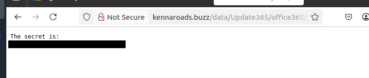

The `office365/` folder contained an encoded string. Note the URL path is **case-sensitive**: `Office365` returned 404, `office365` worked.

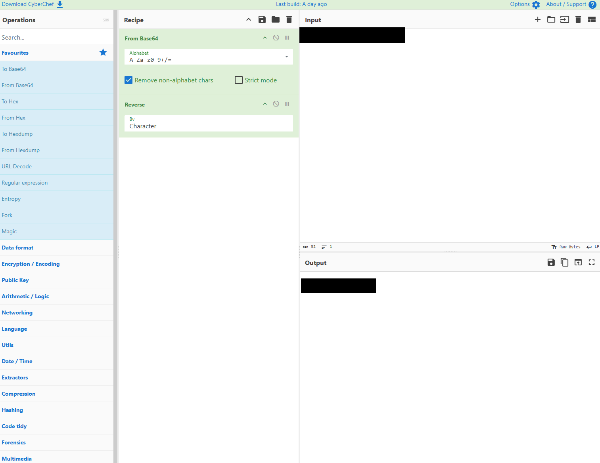

Decoded in CyberChef with a two-step recipe: **From Base64, then Reverse**. Recognizable as Base64 by the mixed upper/lowercase alphanumerics and the trailing `=` padding. Base64 is **encoding, not encryption**: no key is required, so it hides data from a casual glance or simple filter, not from an analyst. *(Flag value omitted from this public write-up.)*

---

## Indicators of Compromise

| Type | Value | Notes |
|---|---|---|
| Sender email | `Accounts.Payable@groupmarketingonline.icu` | Campaign sender |
| Domain | `groupmarketingonline.icu` | Lookalike vendor domain |
| Domain | `kennaroads.buzz` | Phishing page and kit host |
| URL | `http://kennaroads.buzz/data/Update365/office365/` | Credential harvesting page |
| Exfil email | `m3npat@yandex.com` | Receives stolen credentials |
| File | `Direct Credit Advice.html` | HTML redirector attachment |
| File | `Update365.zip` | Phishing kit |
| SHA256 | `ba3c15267393419eb08c7b2652b8b6b39b406ef300ae8a18fee4d16b19ac9686` | Phishing kit |
| String | `Created BY Real Carder` | Kit author signature in logs |

---

## MITRE ATT&CK Mapping

| Technique | ID | Evidence |
|---|---|---|
| Phishing: Spearphishing Attachment | T1566.001 | HTML and "quote" attachments sent to named employees |
| User Execution: Malicious File | T1204.002 | Victim must open the HTML attachment to trigger the redirect |
| Acquire Infrastructure: Domains | T1583.001 | `.icu` sender domain and `.buzz` hosting domain |
| Input Capture: Web Portal Capture | T1056.003 | Fake Microsoft 365 login page capturing credentials |

---

## Recommended Response

**Contain**
- Reset passwords and **revoke active sessions** for all four affected accounts, including those with apparently fake submissions.
- Review Microsoft 365 sign-in logs for each account from June 29 onward: unfamiliar IPs or locations, new MFA methods, and **new inbox forwarding rules** (a common follow-up once an attacker is in).
- Enforce MFA on all affected accounts if not already in place.

**Eradicate**
- Block `groupmarketingonline.icu` and `kennaroads.buzz` at the mail gateway, web proxy, and DNS.
- Search mail logs for every recipient of the campaign and purge the messages org-wide.
- Block the kit hash in endpoint protection.

**Report and recover**
- Report the phishing site to the hosting provider and domain registrar for takedown.
- Report `m3npat@yandex.com` to Yandex abuse.
- Notify affected users, and use this campaign (HTML attachment redirect, pre-filled login, fake error) as a real example in security awareness training.

---

## Lessons Learned

- **Inspect before rendering.** Opening the HTML attachment as source text revealed the entire attack in 11 lines without ever loading the phishing page.
- **Attackers make operational mistakes.** An open directory exposed the kit, the credential log, and the exfil address. Always check parent directories on phishing infrastructure.
- **The exfil address is the critical IOC.** Credentials leave the victim's hands the moment they're submitted; site takedown alone is not remediation.
- **A double password prompt is a pattern, not a glitch.** The kit's fake error flow is built to harvest a second attempt.
