# Summit: Climbing the Pyramid of Pain

**Platform:** TryHackMe (SOC Level 1 challenge room)
**Scenario:** PicoSecure has hired an external penetration tester ("Sphinx") to run malware against a workstation. Each time a sample is detected, the tester modifies it to evade that detection.
**Role:** Detection engineer. Build detections in PicoSecure's security tooling for six successive malware samples, each one forcing a more durable type of detection.
**Outcome:** All six samples detected. The engagement ended with the tester abandoning the attack once detections reached the attacker's own behavior and procedures.

---

## Summary

The room is a hands-on walk up David Bianco's **Pyramid of Pain**, which ranks indicators by how much it costs an attacker when defenders detect them. Hashes sit at the bottom (trivial to change); tactics, techniques, and procedures (TTPs) sit at the top (expensive to change, because they reflect how the attacker actually operates).

| Sample | Indicator detected | Pyramid tier | Tool used |
|---|---|---|---|
| sample1.exe | SHA256 file hash | Hash values | Manage Hashes |
| sample2.exe | C2 server IP address | IP addresses | Firewall Rule Manager |
| sample3.exe | C2 domain | Domain names | DNS Rule Manager |
| sample4.exe | Registry change disabling Defender | Host artifacts | Sigma rule (Sysmon) |
| sample5.exe | Beacon timing and size pattern | Network artifacts / tools | Sigma rule (Sysmon) |
| sample6.exe | Recon commands staging output to a file | TTPs | Sigma rule (Sysmon) |

Each step up the pyramid made the next evasion more expensive for the attacker: recompiling (seconds), switching cloud IPs (minutes), registering new domains (hours and money), rewriting tooling (days), and finally retraining their own habits.

---

## Investigation

### Sample 1: File hash

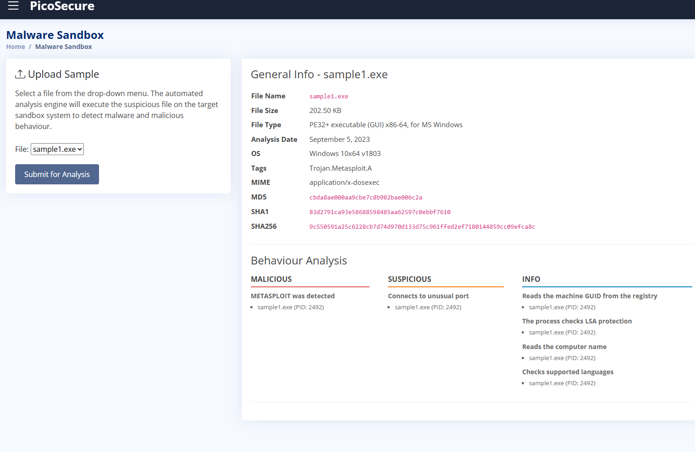

The PicoSecure malware sandbox identified `sample1.exe` as a 64-bit Windows executable tagged `Trojan.Metasploit.A`. Behavior analysis flagged a Metasploit detection and a connection to an unusual port.

The most precise indicator available was the file's hash. I added the **SHA256** to the hash blocklist:

```
SHA256: 9c550591a25c6228cb7d74d970d133d75c961ffed2ef7180144859cc09efca8c
```

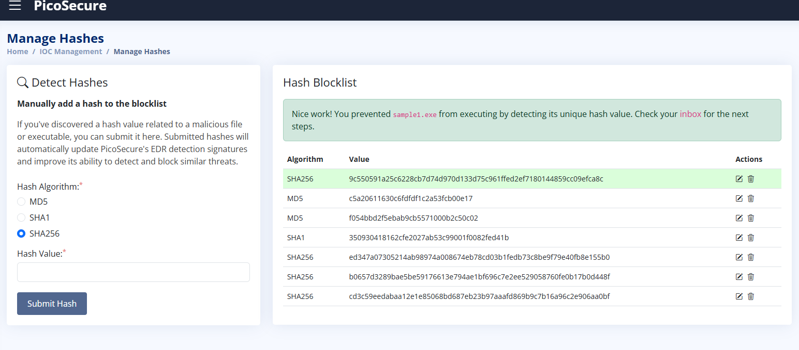

**Why it worked, and why it wouldn't last:** a hash is the highest-confidence indicator there is, since it matches exactly one file. That is also its weakness. The tester recompiled the malware, which changed every byte of the hash, and `sample2.exe` ran without issue.

### Sample 2: IP address

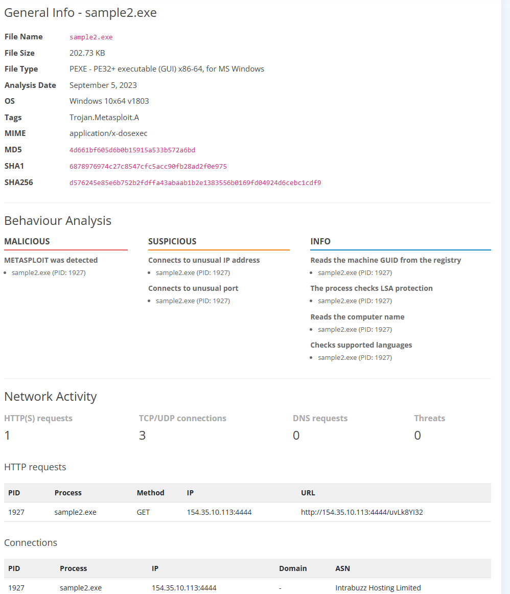

`sample2.exe` had new hashes, but the sandbox showed it making an HTTP GET request to a remote server:

```
http://154.35.10.113:4444/uvLk8YI32
```

The connections table attributed `154.35.10.113` to **Intrabuzz Hosting Limited**. Other traffic in the sample went to Microsoft-owned infrastructure, which I left alone: blocking legitimate Microsoft services would cause false positives without stopping the attacker. A small hosting provider receiving a GET on a nonstandard port (4444, a Metasploit default) is the command-and-control server.

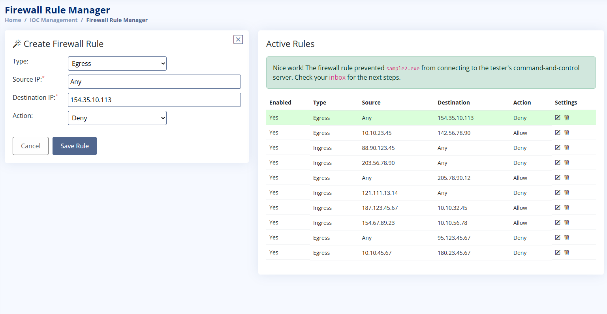

| Field | Value | Reasoning |
|---|---|---|
| Type | Egress | The infected host initiates the connection outbound |
| Source IP | Any | Any internal machine could be infected |
| Destination IP | 154.35.10.113 | The attacker's C2 server |
| Action | Deny | Block the callout |

**Evasion:** the tester signed up with a cloud provider and moved the server to a new IP.

### Sample 3: Domain name

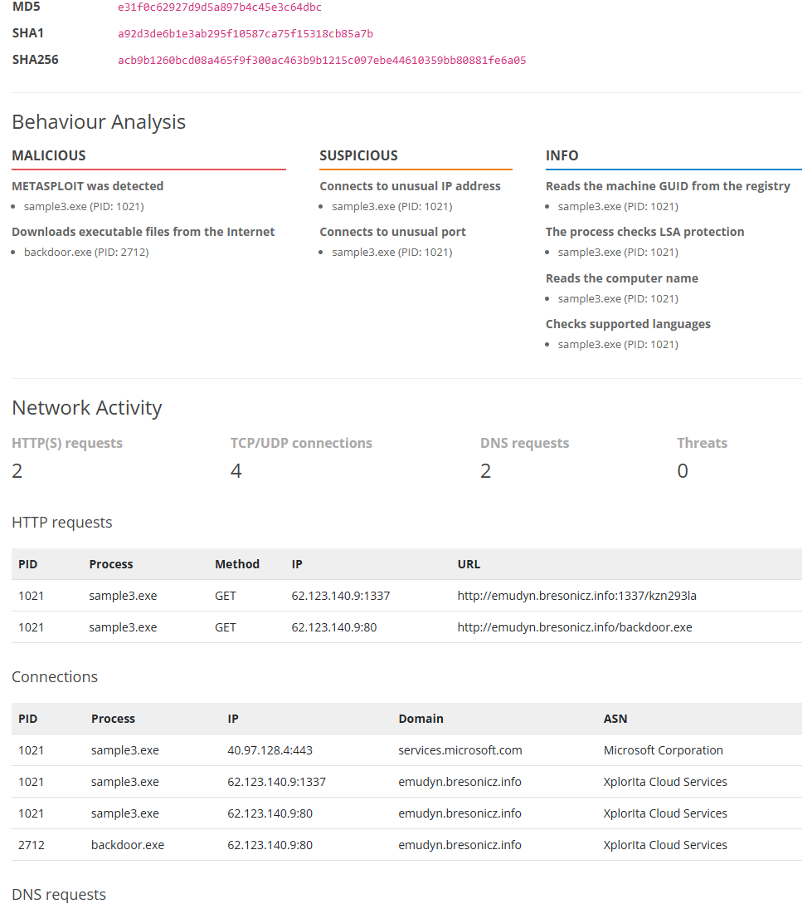

`sample3.exe` reached a new IP (`62.123.140.9`, Xplorlta Cloud Services), but this time through a domain name, and used it to download a second-stage payload:

```
http://emudyn.bresonicz.info/backdoor.exe
```

Blocking the new IP would only last until the next IP change. The domain is more durable: the malware resolves it every time, whatever IP sits behind it. I blocked the **domain**, not the full URL, since the path after the domain is trivial for the attacker to change.

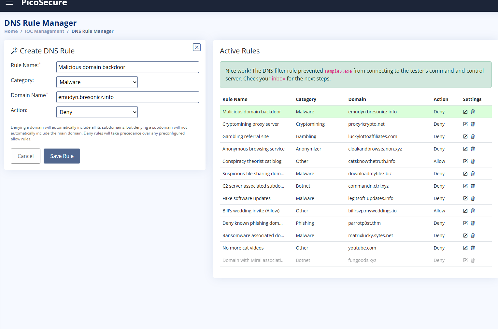

| Field | Value |
|---|---|
| Rule name | Malicious domain backdoor |
| Category | Malware |
| Domain | `emudyn.bresonicz.info` |
| Action | Deny |

**Evasion:** the tester registered new domains (`cranes0ft.iniware.xyz` appeared in sample 4). This is the first point where evasion cost the attacker real money and effort.

### Sample 4: Host artifact (registry)

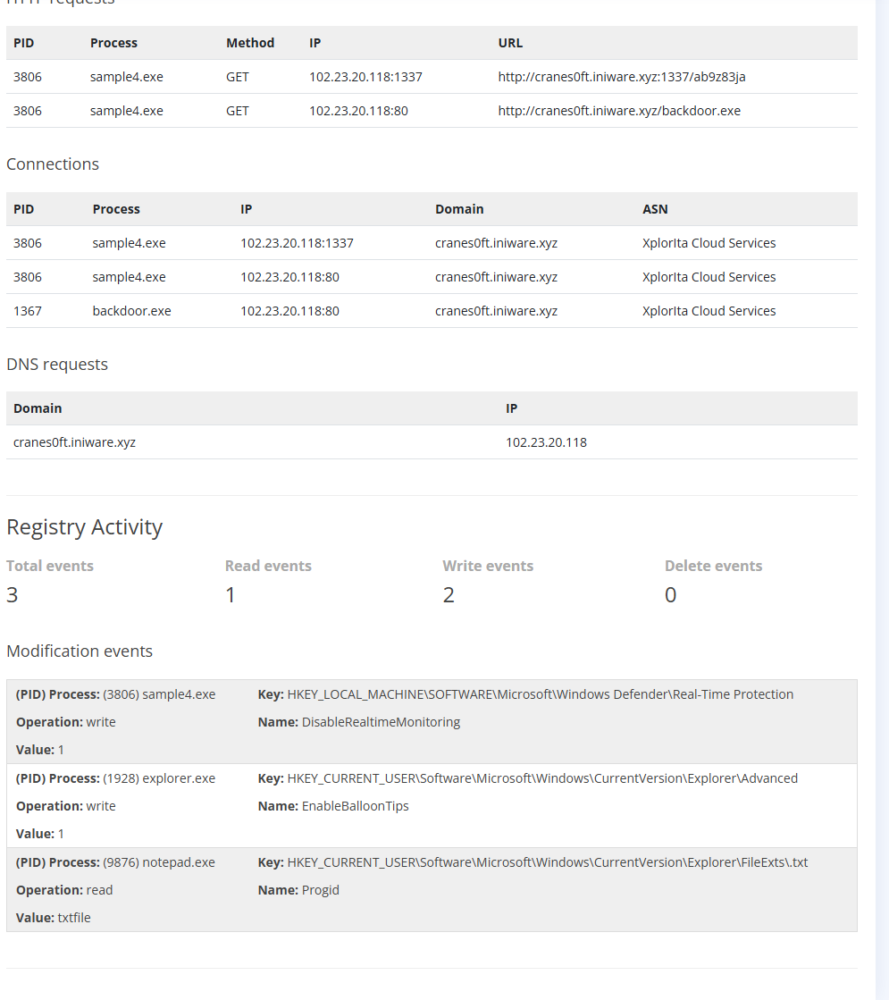

With hashes, IPs, and domains all rotating, the next detection had to target what the malware **does to the host**. The sandbox's registry activity showed three events:

| Process | Operation | Key / Name | Assessment |
|---|---|---|---|
| sample4.exe | write | `HKLM\SOFTWARE\Microsoft\Windows Defender\Real-Time Protection` / `DisableRealtimeMonitoring` = 1 | **Malicious:** turns off antivirus |
| explorer.exe | write | `...\Explorer\Advanced` / `EnableBalloonTips` = 1 | Benign UI setting, written by explorer.exe |
| notepad.exe | read | `...\Explorer\FileExts\.txt` / `Progid` | Benign file-association lookup |

Only one event was written by the malware itself, and it disables Windows Defender's real-time protection. The malware needs this step to operate undetected, which makes it a durable detection point.

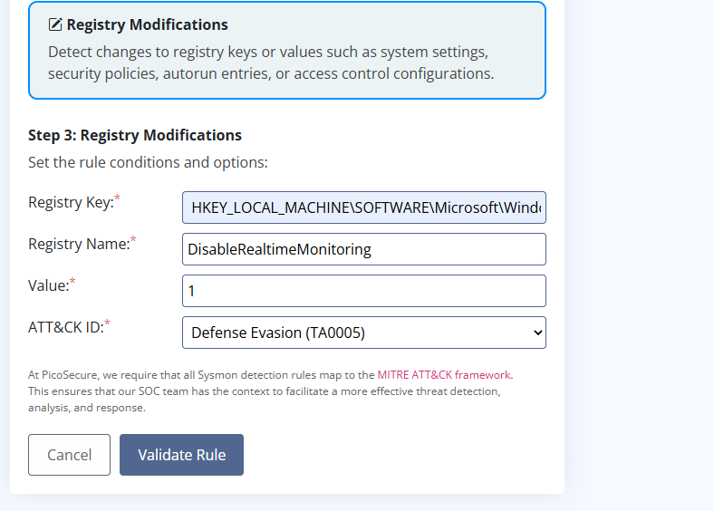

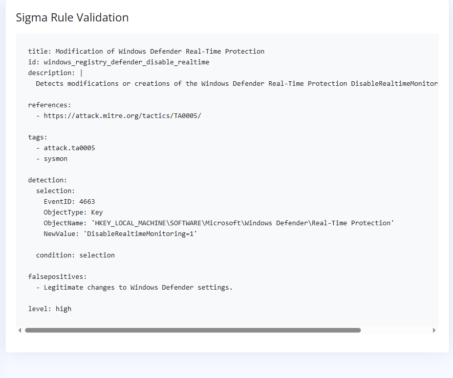

- Log source: Sysmon, registry modifications
- Key: `HKEY_LOCAL_MACHINE\SOFTWARE\Microsoft\Windows Defender\Real-Time Protection`
- Name / value: `DisableRealtimeMonitoring` = `1`
- ATT&CK tactic: **Defense Evasion (TA0005)**

> **Note:** the room's generated rule uses Windows Security Event ID 4663 (object access). In a production Sysmon deployment, a registry value change like this is logged as **Sysmon Event ID 13** (RegistryEvent – Value Set), which is what a real rule would key on.

**Evasion:** the tester had to rewrite their tooling to avoid touching that setting. Sphinx's response described it as a time-consuming and costly change.

### Sample 5: Behavioral network pattern (beaconing)

For `sample5.exe`, the tester moved all logic to a back-end server so protocols and host artifacts could change freely, and supplied 12 hours of the victim's outbound connection logs.

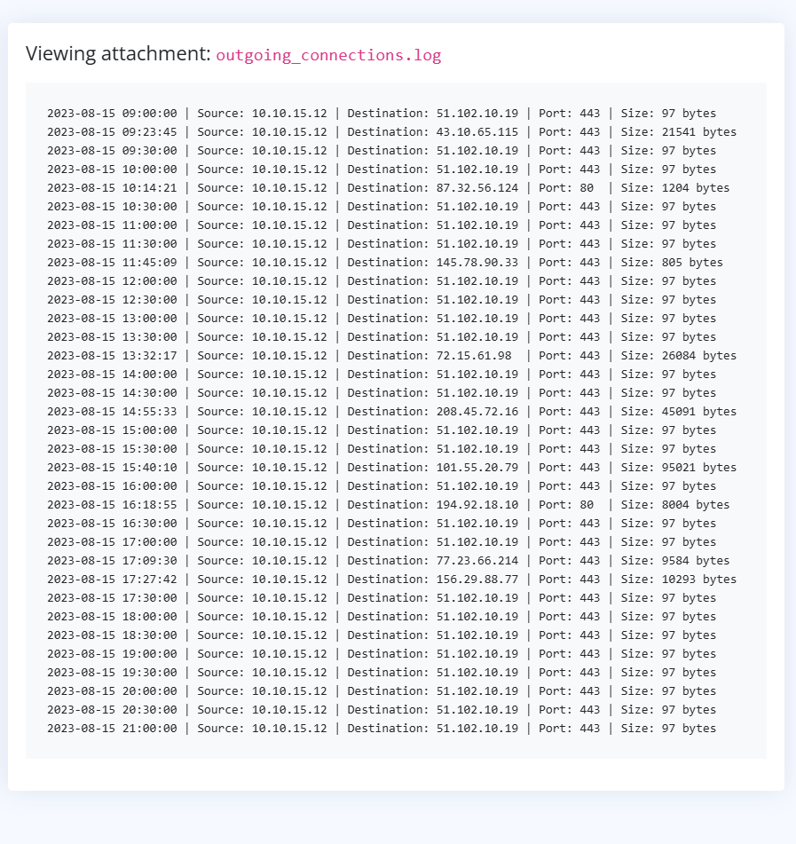

All traffic came from the same host (`10.10.15.12`). Most connections were irregular in timing, went to different destinations, and varied widely in size (800 bytes to 95 KB), consistent with normal browsing. One pattern stood out:

- Destination `51.102.10.19`, port 443
- **Exactly 97 bytes** every time
- **Exactly every 30 minutes**, on the hour and half hour, from 09:00 to 21:00

Human activity is never this regular. A small, fixed-size connection on a fixed schedule is a **C2 beacon**: the implant checking in for instructions.

My first rule pinned the destination IP and port, and was rejected because the attacker had "evolved." That was the lesson of this sample: **IP and port are cheap for the attacker to change; the beacon's size and interval are properties of the tool itself.** The final rule detects the behavior regardless of where it goes.

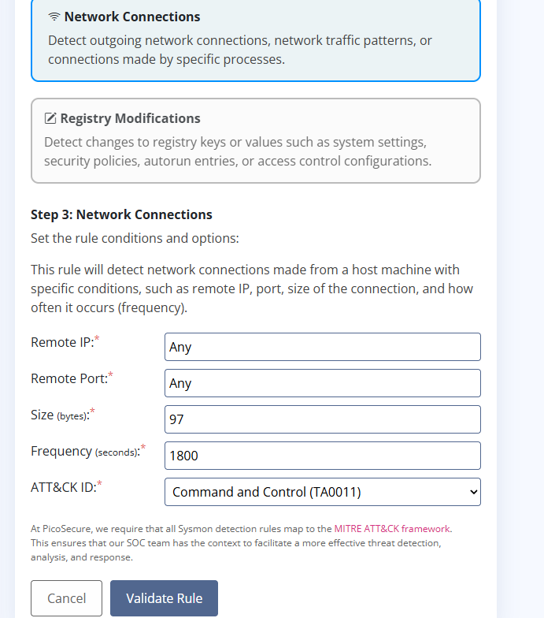

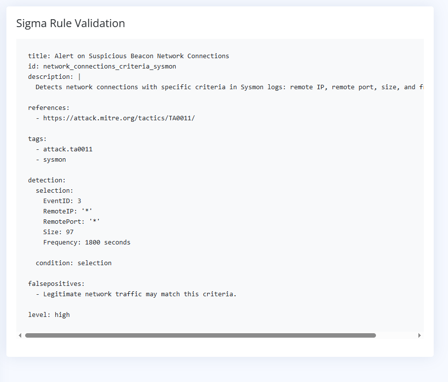

| Field | Value |
|---|---|
| Log source | Sysmon, network connections (Event ID 3) |
| Remote IP | Any |
| Remote port | Any |
| Size | 97 bytes |
| Frequency | 1800 seconds |
| ATT&CK tactic | **Command and Control (TA0011)** |

> **Note:** Sysmon logs individual connections, not intervals. In practice, beacon detection like this is done by aggregating connection events in a SIEM or network monitoring tool and alerting on regular timing and consistent size.

**Evasion:** the tester had to build an entirely new tool and learn to use it.

### Sample 6: TTPs (attacker procedures)

For the final sample, the tester provided the commands they had run on victims across all previous samples:

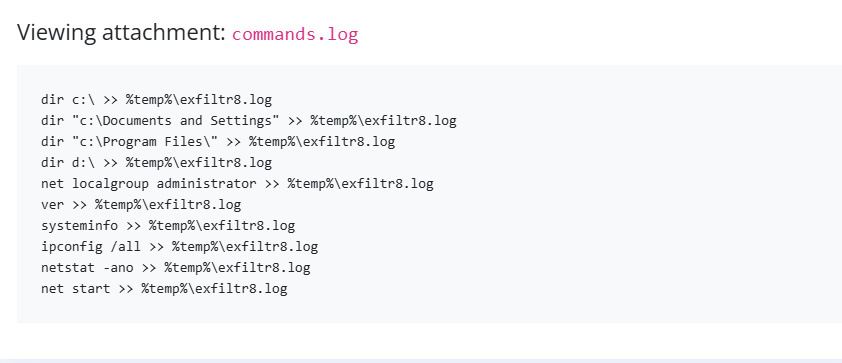

```
dir c:\ >> %temp%\exfiltr8.log
dir "c:\Documents and Settings" >> %temp%\exfiltr8.log
dir "c:\Program Files\" >> %temp%\exfiltr8.log
dir d:\ >> %temp%\exfiltr8.log
net localgroup administrator >> %temp%\exfiltr8.log
ver >> %temp%\exfiltr8.log
systeminfo >> %temp%\exfiltr8.log
ipconfig /all >> %temp%\exfiltr8.log
netstat -ano >> %temp%\exfiltr8.log
net start >> %temp%\exfiltr8.log
```

Every command is **host discovery**: drive and file listings, admin group membership, OS version, system details, network configuration, active connections, and running services. None of them change the system; they only gather information. And every one appends (`>>`) its output to the same staging file in the temp folder, ready to be exfiltrated.

That habit, running the same recon routine and funneling everything into one file, is the attacker's **procedure**. It persisted across every tool and sample they used.

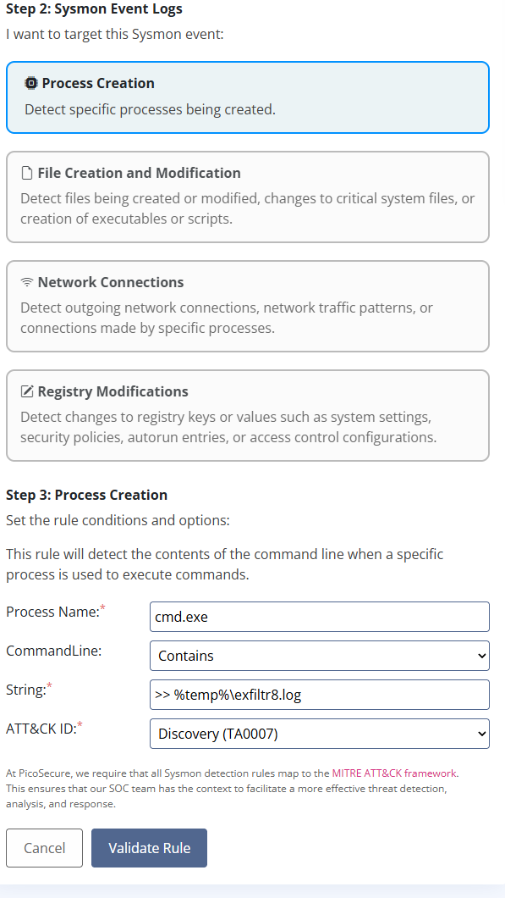

| Field | Value |
|---|---|
| Log source | Sysmon, process creation |
| Process name | `cmd.exe` |
| CommandLine | Contains `>> %temp%\exfiltr8.log` |
| ATT&CK tactic | **Discovery (TA0007)** |

Process creation is the right event type because each command launches a process, and Sysmon records its full command line. That command line shows both *what* the attacker is doing and *where* the output is going.

**Result:** the tester abandoned the engagement, stating that changing their own techniques would require retraining and extensive research.

---

## MITRE ATT&CK Mapping

| Tactic | Technique | ID | Evidence |
|---|---|---|---|
| Command and Control | Application Layer Protocol: Web Protocols | T1071.001 | HTTP callouts (samples 2–4) and 30-minute HTTPS beacon (sample 5) |
| Command and Control | Ingress Tool Transfer | T1105 | `backdoor.exe` downloaded from the C2 domain (samples 3–4) |
| Defense Evasion | Impair Defenses: Disable or Modify Tools | T1562.001 | `DisableRealtimeMonitoring` set to 1 (sample 4) |
| Discovery | System Information Discovery | T1082 | `systeminfo`, `ver` |
| Discovery | File and Directory Discovery | T1083 | `dir` across drives and folders |
| Discovery | Permission Groups Discovery: Local Groups | T1069.001 | `net localgroup administrator` |
| Discovery | System Network Configuration Discovery | T1016 | `ipconfig /all` |
| Discovery | System Network Connections Discovery | T1049 | `netstat -ano` |
| Discovery | System Service Discovery | T1007 | `net start` |
| Collection | Data Staged: Local Data Staging | T1074.001 | All output appended to `%temp%\exfiltr8.log` |

---

## Indicators of Compromise

| Type | Value | Sample |
|---|---|---|
| SHA256 | `9c550591a25c6228cb7d74d970d133d75c961ffed2ef7180144859cc09efca8c` | sample1.exe |
| IP | `154.35.10.113` (port 4444) | sample2.exe C2 |
| Domain | `emudyn.bresonicz.info` | sample3.exe C2 and payload host |
| Domain | `cranes0ft.iniware.xyz` | sample4.exe C2 and payload host |
| IP | `51.102.10.19` | sample5.exe beacon destination |
| File | `backdoor.exe` | Second-stage payload |
| File | `%temp%\exfiltr8.log` | Discovery staging file |
| Registry | `HKLM\...\Windows Defender\Real-Time Protection\DisableRealtimeMonitoring = 1` | sample4.exe |

---

## Lessons Learned

- **Low-tier indicators are fast but fragile.** Hashes, IPs, and domains stop a specific threat right now, and should still be blocked. They are not durable on their own.
- **Pin what the attacker can't easily change.** When building the beacon rule, the attacker's IP and port were wildcarded and the size and interval were pinned. The question to ask about every field: *how long would it take the attacker to change this?*
- **Separate malicious activity from legitimate infrastructure.** Microsoft-owned connections and Explorer/Notepad registry events appeared alongside the malware. Detecting those would have produced false positives without stopping anything.
- **Behavior hides in normal traffic.** The sample 5 beacon was buried among ordinary browsing. Its regularity, not its destination, gave it away.
- **TTP detections end engagements.** Each tier up raised the attacker's cost, and detecting their procedures made continuing not worth it.
- **Rule improvement for production:** the sample 6 rule pins the filename `exfiltr8.log`, which the attacker could rename. A more durable version would alert on multiple discovery commands (`systeminfo`, `net localgroup`, `netstat`, etc.) redirecting output into the temp directory within a short time window, regardless of filename.
